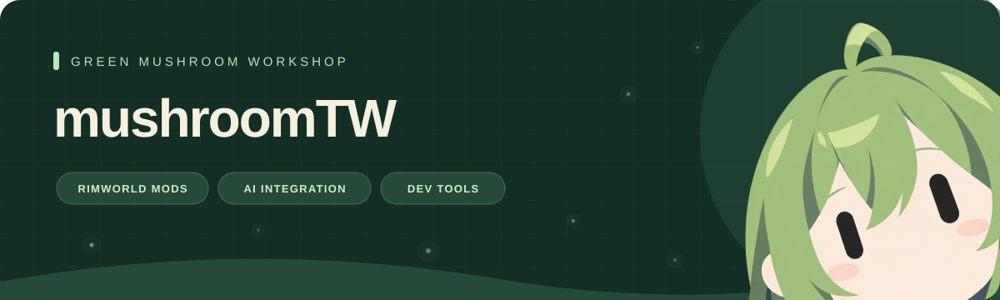

  

---

### Hi, I’m mushroomTW 🍄

I build RimWorld mods, LLM integrations, and developer tools.
My projects span faster game loading, AI-powered colonies, and Discord integrations for development activity.

### RimWorld Projects

| Project | What it does | Focus |
| :--- | :--- | :--- |
| **[Faster Game Loading — Continued](https://github.com/mushroomTW/FasterGameLoading---Continued)** | Reduces game startup time for large mod lists. | `Game Mod` · `Performance` |
| **[RimAgent](https://github.com/mushroomTW/RimAgent)** | An in-game AI agent for inspecting your colony and issuing orders in natural language. | `Game Mod` · `AI` |
| **[RimLLM Framework](https://github.com/mushroomTW/RimLLM-Framework)** | A shared LLM SDK for RimWorld mods, with multiple providers and automatic failover. | `Game Mod` · `LLM` · `SDK` |
| **[rimworld-mod-mcp](https://github.com/mushroomTW/rimworld-mod-mcp)** | A local MCP server for researching game APIs and Defs, and creating, building, and testing mods. | `MCP` · `.NET` · `Developer Tools` |
| **[Artifact Weapon Arsenal](https://github.com/mushroomTW/Artifact-Weapon-Arsenal)** | My first RimWorld mod. | `Game Mod` |

### Other Projects

| Project | What it does | Focus |
| :--- | :--- | :--- |
| **[FreeClaudeDesktop](https://github.com/mushroomTW/FreeClaudeDesktop)** | Connects Claude Desktop to OpenAI-compatible or Anthropic-compatible gateways through a local API proxy. | `Rust` · `AI Tools` |
| **[Codex Discord Presence](https://github.com/mushroomTW/codex-discord-presence)** | Displays Codex development activity and work details in Discord Rich Presence. | `JavaScript` · `Developer Tools` |
| **[Claude Discord Presence](https://github.com/mushroomTW/claude-discord-presence)** | Displays Claude Desktop development activity and work details in Discord Rich Presence. | `JavaScript` · `Developer Tools` |
| **[MushroomTW Skills](https://github.com/mushroomTW/MushroomTW-Skills)** | Agent Skills for project documentation, dependency decisions, code quality, and mod testing. | `Agent Skills` · `Development Workflow` |
| **[Steam Workshop GIF Library](https://github.com/mushroomTW/GIF-library-used-in-Steam-Workshop)** | A public GIF library for Steam Workshop item descriptions. | `Asset Library` · `Steam Workshop` |

### Technologies & Interests

**Game Modding**　C# / .NET / RimWorld  
**AI Integration**　LLM / Microsoft.Extensions.AI / OpenAI-compatible API  
**Tools & Integrations**　Rust / JavaScript / Local API Proxies / Discord Rich Presence

